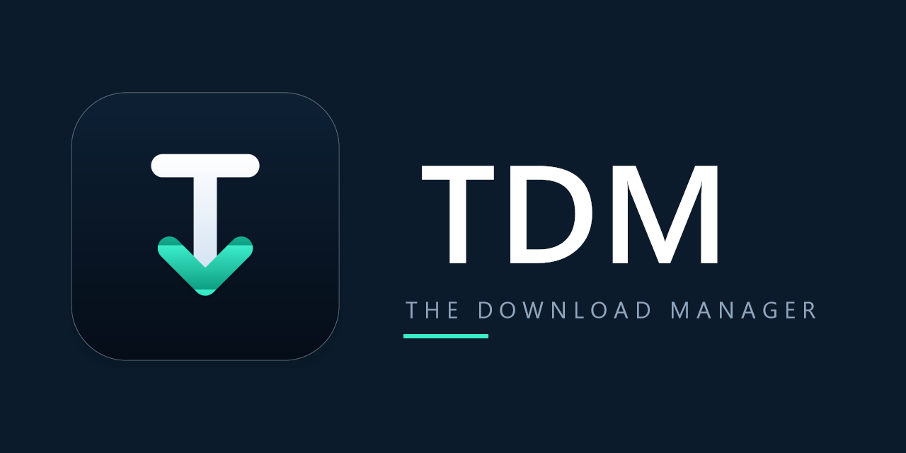
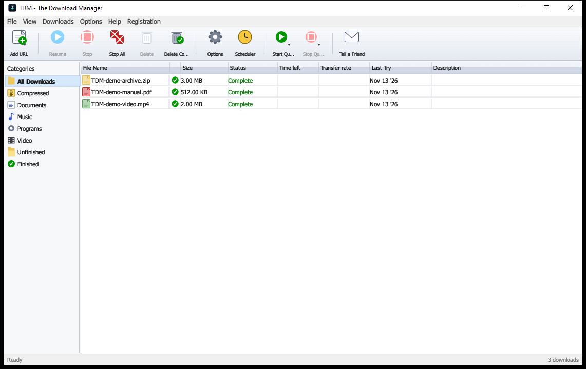
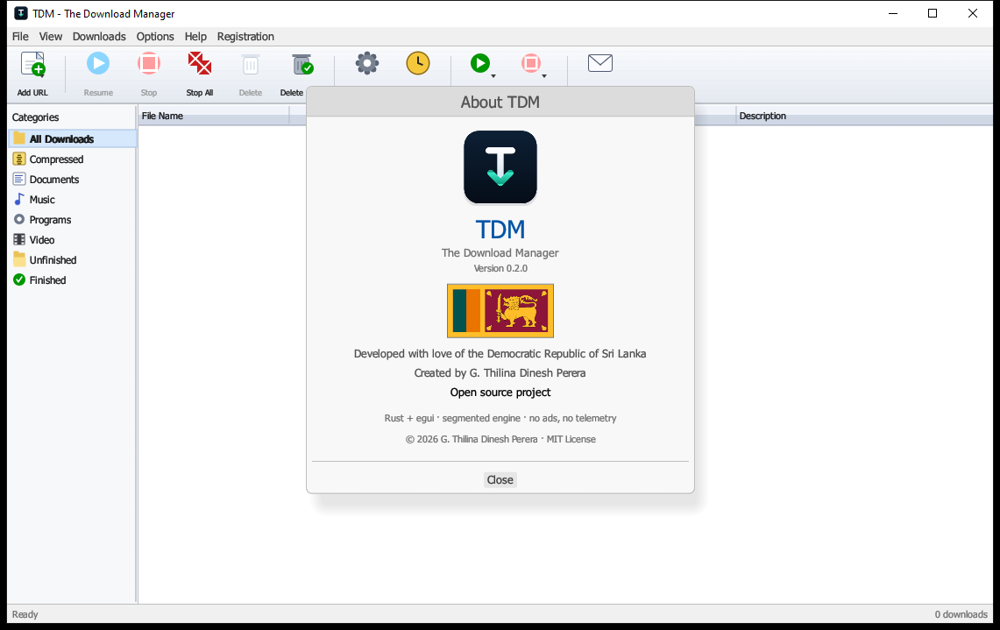
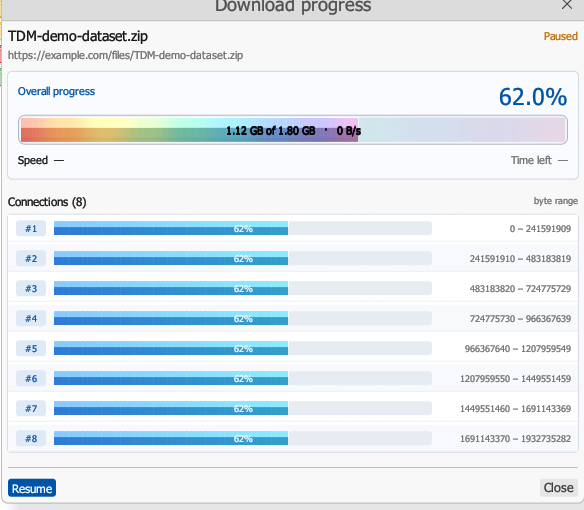

<p align="center">
  
</p>

<h1 align="center">TDM — The Download Manager</h1>

<p align="center">
  <b>A fast, segmented download manager for Windows with a classic desktop UI — written in Rust.</b><br>
  Multi-connection transfers, resume, HLS/DASH video and a native egui interface.<br>
  Open source, local, no ads, no telemetry.
</p>

<p align="center">
  
  
  
  
  
</p>

<p align="center">
  <a href="#features">Features</a> ·
  <a href="#screenshots">Screenshots</a> ·
  <a href="#install">Install</a> ·
  <a href="#build-from-source">Build</a> ·
  <a href="#quick-start">Quick start</a> ·
  <a href="#architecture">Architecture</a> ·
  <a href="#license">License</a>
</p>

<br>

<p align="center">
  
  <br>
  <sub>The main window — segmented transfers, categories, and the per-download list.</sub>
</p>

> [!NOTE]
> TDM is an independent open-source project. Use it only for content you own or are
> authorized to download, and respect the terms of service of the sites you use.

<br>

<table>
  <tr>
    <td width="25%" valign="top">
      <h3>⚡ Segmented engine</h3>
      Probes the server, splits the file into N ranges and downloads them in parallel.
      Per-segment checkpoints make pause/resume safe, even after a crash.
    </td>
    <td width="25%" valign="top">
      <h3>🎬 Video downloads</h3>
      HLS and DASH manifests, separate audio tracks, quality selection, then a lossless
      ffmpeg remux — no re-encoding.
    </td>
    <td width="25%" valign="top">
      <h3>🔄 Resume and recovery</h3>
      Per-segment checkpoints, automatic retries and resumable HLS/DASH parts mean
      interrupted transfers continue where they left off.
    </td>
    <td width="25%" valign="top">
      <h3>🪟 Native and small</h3>
      One ~10 MB executable, no installer, no runtime, no Electron. A native egui window
      that minimizes to the tray, optional start with Windows, and a separate console binary.
    </td>
  </tr>
</table>

<br>

## Features

### Engine

- **Segmented downloads** — probe with `Range: bytes=0-0`, split into N connections
  (default 8), one socket per range, sparse preallocated file.
- **Resume** — per-segment counters checkpointed every 400 ms; closing the window or
  `Ctrl+C` pauses, the next run continues from the checkpoint.
- **Fallback** — servers that ignore `Range` are streamed once; servers without
  `Content-Length` are streamed to EOF.
- **Retries** with exponential backoff and jitter, resuming mid-range.
- **Cookies, Referer, User-Agent, Basic auth, arbitrary headers**, SHA-256 verification.
- **Bandwidth limit** — token bucket shared by all connections.
- **Queue, categories, persistence** — one JSON record per download in `%APPDATA%\tdm`
  (override with `TDM_HOME`).

### Video (HLS / DASH)

`tdm-cli video` parses a manifest, downloads every segment in parallel and remuxes with
ffmpeg (`-c copy`).

```bat
tdm-cli video https://example.com/hls/master.m3u8
tdm-cli video https://example.com/dash/manifest.mpd --quality 720 -o movie.mp4
tdm-cli video https://example.com/watch/page.html          :: scans the page for .m3u8/.mpd
tdm-cli video <manifest> --list                            :: show variants / representations
tdm-cli video <manifest> --audio-only                      :: save just the audio (m4a)
```

- **HLS**: master + media playlists, `EXT-X-MAP` init segments, byte-range segments,
  separate `EXT-X-MEDIA` audio renditions.
- **DASH**: `SegmentTemplate` with `$Number$`/`$Time$`, `SegmentTimeline`, `SegmentList`,
  separate video/audio `AdaptationSet`s, ISO-BMFF init + fragments.
- **Muxing**: video-only + audio-only → mp4; TS → mp4; audio-only → m4a.
- Rejected with a clear message: AES-128 encrypted HLS, live playlists, DRM.
- Requires `ffmpeg.exe` on `PATH`, or set `TDM_FFMPEG` to its full path.

### Download details

The download list supports per-column resizing, multi-selection with Ctrl/Shift-click,
and a right-click menu for details, pause/resume, copy URL, open folder, or removal.
The progress window shows overall speed and each connection's byte range.

<br>

## Screenshots

<table>
  <tr>
    <td width="50%" valign="top">
      
      <br><sub>The download list, category filter and toolbar.</sub>
    </td>
    <td width="50%" valign="top">
      
      <br><sub>Help → About: source, MIT license, issues and third-party notices.</sub>
    </td>
  </tr>
  <tr>
    <td colspan="2" valign="top">
      
      <br><sub>Download progress: overall rainbow bar and per-connection segments.</sub>
    </td>
  </tr>
</table>

<br>

## Install

TDM targets **Windows 10 / 11 (x64)**.

There is no binary release yet. Build from source with the instructions below; the
resulting `tdm.exe` opens without a console window, and `tdm-cli.exe` is the same engine
for terminals and scripts.

<br>

## Build from source

Requirements:

- Rust stable with the `x86_64-pc-windows-gnu` target
- MinGW-w64 (GNU toolchain)
- Optional: `ffmpeg.exe` for video muxing

```bat
git clone https://github.com/the-download-manager/tdm
cd tdm

build.cmd build --release    :: cargo build --release with the GNU target
build.cmd test               :: 22 tests
```

`build.cmd` keeps build output in `target-build\` and uses the Rust/MinGW toolchain on
your `PATH`. The release binaries end up in
`target-build\x86_64-pc-windows-gnu\release\`. Both are self-contained apart from Windows
system DLLs; `src/main_gui.rs` carries `#![windows_subsystem = "windows"]`, which is what
removes the console window.

<br>

## Quick start

### GUI

Double-click `tdm.exe`, press **Add URL** (`Ctrl+N`), paste a link and start.

Shortcuts: `Ctrl+N` add · `Enter` details · `Space` pause/resume · `Del` remove ·
`↑`/`↓` select · `Esc` close dialog.

### CLI

```bat
tdm-cli add https://example.com/big.iso -n 16 --limit 10M
tdm-cli list
tdm-cli info 1a2b3c4d
tdm-cli resume              :: everything paused/failed
tdm-cli remove 1a2b3c4d --delete-file
tdm-cli config set connections 16
tdm-cli serve --port 8484   :: local API + browser dashboard
```

### Local API

```bat
curl -X POST http://127.0.0.1:8484/api/downloads ^
  -H "Content-Type: application/json" ^
  -d "{\"url\":\"https://example.com/file.zip\",\"connections\":8}"
```

The dashboard is at `http://127.0.0.1:8484`. Endpoints cover add, pause, resume and delete.

<br>

## Configuration

| Setting | Where |
|---|---|
| Home directory (config, records, logs) | `%APPDATA%\tdm`, override with `TDM_HOME` |
| Download folder, connections, speed limit, proxy | GUI **Options** or `tdm-cli config` |
| ffmpeg location | `ffmpeg.exe` on `PATH`, or `TDM_FFMPEG` |
| Local API port | `api_port` in config (default `8484`) |

<br>

## Architecture

<details>
<summary><b>Project layout</b></summary>

```text
src/
  main_gui.rs  tdm.exe: GUI subsystem entry point (no console window)
  main_cli.rs  tdm-cli.exe: console entry point
  gui.rs       egui window: menu, toolbar, categories, table, dialogs
  cli.rs       clap commands, progress bars, Ctrl+C -> pause
  engine.rs    segmented workers, checkpointing, finalize (rename + checksum)
  http.rs      probe (size/ranges/name/validators), range GET, headers/auth
  model.rs     Download / Segment / Status (serde-persisted)
  store.rs     file-per-download database, atomic writes
  speed.rs     token-bucket limiter
  server.rs    axum API + dashboard + queue semaphore
  media.rs     HLS/DASH parsing, parallel segment download, ffmpeg mux
  config.rs    JSON config (%APPDATA%\tdm\config.json or TDM_HOME)
  util.rs      formatting, filename hygiene, hashing, categories
```

</details>

- **Engine first:** a data model and a download engine, with a thin egui UI on top.
- **One record per download** in `%APPDATA%\tdm\downloads`, written atomically.
- **Local HTTP API** so scripts and other tools use the same engine as the GUI.

<br>

## Tests

```bat
build.cmd test
```

22 tests: 18 unit (engine, HTTP helpers, HLS/DASH parsers, segment templates) and
4 integration tests against a live Range-capable HTTP server (parallel ranges,
pause/resume checkpoint, range-less fallback, retry of transient 500s).

<br>

## Limitations

- **DRM-protected streams** cannot be downloaded or decrypted.
- Live HLS, AES-128 encrypted HLS and site-grabber/FTP features are out of scope for now.
- Scheduler time windows and kernel/WFP capture drivers are not implemented.
- Windows only. The engine is portable, but the GUI targets the Windows desktop.

<br>

## Contributing

Issues and pull requests are welcome. Please run `build.cmd test` before opening a PR,
keep changes focused, and describe the Windows version you tested on.

<br>

## License

TDM is released under the [MIT License](LICENSE).

Copyright (c) 2026 G. Thilina Dinesh Perera.

The TDM name, "The Download Manager" and the TDM logo are unregistered trademarks and
are not covered by the MIT license. See [NOTICE.md](NOTICE.md) for trademark,
third-party and acceptable-use notices.

<br>

## Credits

- Built with [Rust](https://www.rust-lang.org/) and [egui / eframe](https://github.com/emilk/egui).
- The Sri Lankan flag image is public-domain artwork from [flagcdn](https://flagcdn.com).
- Tahoma is loaded from the local Windows installation at runtime; it is not bundled.
- Thanks to every Rust crate author whose work this project depends on.

<p align="center">
  <sub>Built with ❤️ in Sri Lanka · TDM — The Download Manager</sub>
</p>
